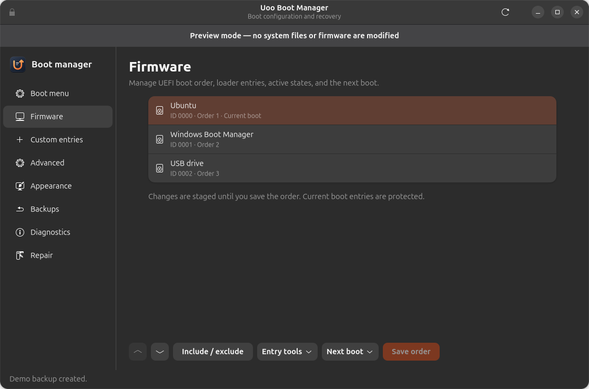
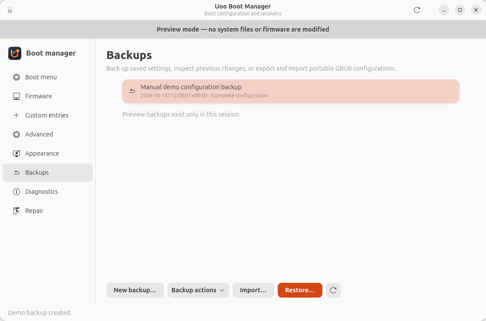
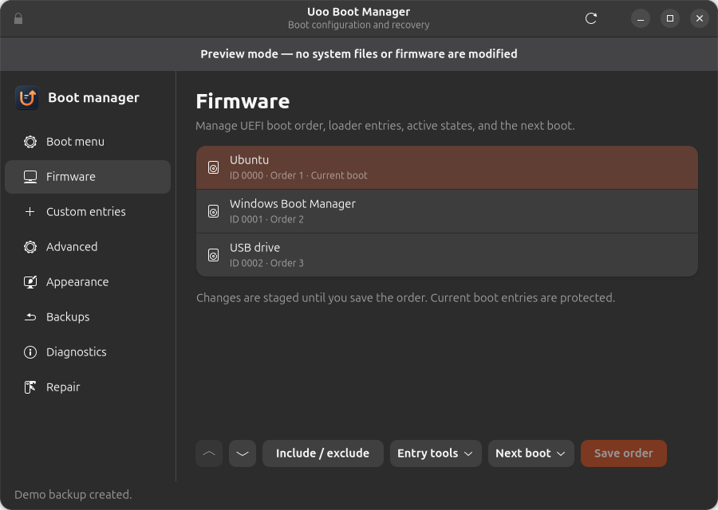

<p align="center">
  
</p>

<h1 align="center">Uoo Boot Manager</h1>

<p align="center">
  Native boot configuration and recovery for Ubuntu and Windows 11.<br>
  Manage boot menus, UEFI entries, backups, and supported bootloader repairs.
</p>

<p align="center">
  <a href="https://github.com/jomardyan/uoo-boot-manager/actions/workflows/verify.yml?query=branch%3Amain"></a>
  <a href="https://github.com/jomardyan/uoo-boot-manager/actions/workflows/windows.yml?query=branch%3Amain"></a>
  <a href="https://github.com/jomardyan/uoo-boot-manager/releases"></a>
  <a href="LICENSE"></a>
</p>

<p align="center">
  <a href="#downloads">Downloads</a> ·
  <a href="#screenshots">Screenshots</a> ·
  <a href="#features">Features</a> ·
  <a href="#getting-started">Getting started</a> ·
  <a href="#documentation">Documentation</a>
</p>

Uoo brings boot settings into a desktop application that follows your operating
system's appearance and interaction patterns: **GTK4/libadwaita on Ubuntu** and
**WPF Fluent on Windows 11**. The desktop runs under your normal user account;
system changes authenticate through the installed administrator helper.

## Downloads

Choose a package from [GitHub Releases](https://github.com/jomardyan/uoo-boot-manager/releases).
For development builds, open a successful [Linux](https://github.com/jomardyan/uoo-boot-manager/actions/workflows/verify.yml)
or [Windows](https://github.com/jomardyan/uoo-boot-manager/actions/workflows/windows.yml)
workflow run and download its **Artifacts**.

| Platform or format | Packages | Architecture | Guide |
| --- | --- | --- | --- |
| Ubuntu 24.04+ | `.deb` | Architecture-independent; install tested on x64 and ARM64 | [Linux packages](docs/PACKAGING.md) |
| Windows 11 | Setup `.exe`, self-contained `.zip` | x64, ARM64 | [Windows installation](docs/WINDOWS.md#install-and-start) |
| Fedora / openSUSE | `.rpm` | `noarch` | [Runtime requirements](docs/PACKAGING.md) |
| Arch Linux / Manjaro | `.pkg.tar.zst` | `any` | [Runtime requirements](docs/PACKAGING.md) |
| AppImage / Flatpak / Snap | `.AppImage`, `.flatpak`, `.snap` | x64, ARM64 | [Portable and sandboxed packages](docs/PACKAGING.md) |

**Boot-management support:** Ubuntu is the verified Linux backend. Other distro
packages provide the desktop, demo, and available inspection; installing them
does not establish GRUB modification or repair support on those distributions.
Linux bootloader repair currently supports verified x86-64 Ubuntu plain-disk
layouts. AppImage, Flatpak, and Snap require the matching native host package
for authenticated system operations.

Release workflows attach packages and SHA256 manifests to a **draft release**;
assets become publicly available when that release is published. CI artifacts
are retained for 30 days. Builds are not automatically published to APT
repositories, the Snap Store, Flathub, or the AUR.

## Screenshots

The Ubuntu edition in demo mode. Click an image to view it at full size.

**Boot menu — light appearance**

[](docs/images/grub.png)

| UEFI firmware — dark appearance | Backups and restore — light appearance |
| --- | --- |
| [](docs/images/firmware.png) | [](docs/images/backups.png) |

<details>
<summary>View the compact window layout</summary>

[](docs/images/firmware-small.png)

</details>

## Features

| Capability | Ubuntu | Windows 11 |
| --- | --- | --- |
| Boot menu | GRUB default, saved selection, timeout, visibility, one-time boot | Windows Boot Manager default, order, timeout, visibility, one-time boot |
| Entry management | Managed Linux and EFI chainloader entries | Rename, copy, and remove supported Windows loader entries |
| Boot options | Kernel arguments, recovery entries, OS discovery | Safe mode, boot logging, base video, recovery, graphical or legacy menu |
| UEFI firmware | Order, inclusion, activation, next boot, local EFI registrations | Order, inclusion, next boot, local EFI registrations |
| Appearance | GRUB graphics mode, colors, validated PNG background | Native Windows light/dark desktop appearance |
| Backups | Configuration snapshots, restoration, portable import/export | Private BCD/firmware backups, restoration, typed import/export |
| Diagnostics and repair | Supported Ubuntu UEFI and BIOS bootloader repair | Supported repair of the running Windows installation's UEFI boot files |
| Desktop experience | GTK4/libadwaita, keyboard navigation, demo mode | WPF Fluent, keyboard navigation, demo mode |

Changes use backups, state validation, and recovery journals. Uoo never reboots
automatically. Available actions depend on the detected boot mode, installed
tools, storage layout, and platform prerequisites.

## Getting started

### Ubuntu

Download the `.deb` from a published release, then run these commands in the
directory containing the package:

```sh
sudo apt install ./uoo-boot-manager_2.2.0_all.deb
uoo-boot-manager
```

You can also open **Uoo Boot Manager** from the application menu. Installation
does not change boot settings; apply changes from the app when you are ready.

The package installs Python, PyGObject, GTK4, libadwaita, and polkit dependencies.
Ubuntu 24.04+, GTK 4.6+, and libadwaita 1.5+ are required. GRUB controls require an
existing GRUB installation, `update-grub`, and `grub-script-check`; firmware
controls require UEFI mode and `efibootmgr`. UEFI reinstallation requires the
installed Ubuntu signed shim/GRUB packages; BIOS reinstallation requires
`grub-pc-bin`.

### Windows 11

Download the **windows-x64-setup.exe** package for Intel/AMD PCs or
**windows-arm64-setup.exe** for Windows on Arm. Run the installer, then open
**Uoo Boot Manager** from Start. The installers include the .NET runtime;
Windows 11 build 22000 or later is required. Current Windows packages are
unsigned.

The ZIP supports demo mode and available read-only inspection. Install the
application before using administrator actions. See the [Windows guide](docs/WINDOWS.md)
for UAC, BitLocker handling, recovery, and repair requirements.

### Try the Ubuntu demo from source

Clone the repository, enter its directory, and install the desktop dependencies:

```sh
git clone https://github.com/jomardyan/uoo-boot-manager.git
cd uoo-boot-manager
sudo apt install python3-gi gir1.2-gtk-4.0 gir1.2-adw-1
python3 -m uoo --demo
```

The demo uses sample boot entries and does not change the system. Use
`python3 -m uoo --live` for available read-only inspection from source; applying
real changes requires the installed, root-owned helper. Source mode never
elevates user-editable Python code.

## Working with boot settings

On Ubuntu, use the lock button to load protected configuration with
administrator authentication. Each system change requires authentication.
Forms, custom entries, and firmware order remain drafts until applied; closing
or reloading prompts before discarding them. Windows system operations use the
installed helper through UAC.

<details>
<summary>Ubuntu configuration, supported operations, and repair limits</summary>

Uoo stores GRUB settings in `/etc/default/grub.d/zz-uoo.cfg`, managed entries in
`/etc/grub.d/41_uoo`, and private backups in `/var/lib/uoo-boot-manager/backups`.
Other GRUB settings are preserved. Changes are serialized, journaled, verified,
and rolled back when a tool fails; unfinished transactions recover before the
next change.

EFI registration points firmware to an existing `.efi` file; it does not
install another operating system. Mount the selected filesystem before
activating a managed entry or creating/removing a local firmware loader, so
Uoo can verify the file. The currently booted entry is protected. Clear a
scheduled next boot before disabling or removing that entry, and retain at
least one active entry in the boot order.

Managed entries are separate from Ubuntu's generated kernel/OS entries. Use
OS discovery and recovery settings for generated entries. Direct shell editing
of GRUB scripts is not exposed. Imports contain validated settings and managed
entries; they do not execute scripts or apply another computer's firmware
inventory.

Saved and one-time GRUB selection require a verified writable environment
block. Unsupported RAID, LVM, encrypted, or checksumming boot layouts disable
those controls. An independently mounted plain `/boot` partition can support
them. BIOS embedding areas and GRUB snapshots must fit the stated backup
limits; the repair plan explains unsupported layouts before writing.

UEFI repair replaces Ubuntu's installed signed shim, GRUB, and MOK-manager
files in the mounted Ubuntu EFI directory and rebuilds the loader
configuration. It preserves other vendors' files, firmware order, and Secure
Boot settings. BIOS repair backs up boot sectors, the embedding area, and GRUB
files before running the native installer. Review the detected target and type
it to confirm either operation. Backups cannot recover a failed disk or
guarantee recovery from power loss before the app can run again.

</details>

<details>
<summary>Restore and uninstall on Ubuntu</summary>

Restore previous settings from **Backups** while Uoo is installed. Restoration
first saves the current state. Scope matters: a one-time boot backup restores
that choice, an order backup restores order, and a full backup also covers
entry activation and managed GRUB files. Local EFI registrations removed
through Uoo have restoration data; an order-only backup cannot reconstruct
arbitrary deleted network/vendor registrations. Newly added entries are
preserved where possible.

Portable exports contain settings rather than privileged scripts or raw
boot-sector images. Imports apply validated GRUB and managed-entry data;
firmware configuration stays local. Private recovery snapshots remain in the
root-owned backup directory.

```sh
sudo apt remove uoo-boot-manager
```

Uninstalling preserves the GRUB settings drop-in, backups, and previously
applied firmware changes. Restore a backup **before uninstalling** to return
to earlier settings. [Windows uninstall behavior](docs/WINDOWS.md#install-and-start)
is documented separately.

</details>

## Build and validate

Run `make help` for all build and check targets. GNU Make and Bash are required;
see the platform guides for native prerequisites.

On Ubuntu/Debian or Arch/Manjaro, `make deps` installs dependencies for the
operations supported by your host. Use `make deps-windows` or another
`deps-<target>` for a single operation, and `DEPS_ARGS=--dry-run` to preview.
Run it as your normal user; system package commands authenticate with sudo.

```sh
make deps DEPS_ARGS=--dry-run  # Preview dependency setup
make build          # Create the Debian package in dist/
make check          # Build, verify the Debian archive, and run Python tests
make test-gtk       # Run native GTK interaction tests under Xvfb
```

The package build stages files under `build/` and writes outputs to `dist/`.
It does not install the app or change the build machine's boot configuration.
The Python backend uses the standard library; the desktop requires GTK/GI.

Without Make:

```sh
bash scripts/build-deb.sh
python3 scripts/check-package.py dist/uoo-boot-manager_2.2.0_all.deb
python3 -m unittest discover -s tests -v
```

Native GTK tests need desktop dependencies and an isolated display:

```sh
GDK_BACKEND=x11 GSK_RENDERER=cairo xvfb-run -a python3 -m unittest discover -s tests -v
```

The Linux workflow builds and checks Debian, RPM, Arch, AppImage, Flatpak, and
Snap packages. The Windows workflow builds x64/ARM64 installers and ZIPs and
runs model, native provider, live transaction, and desktop checks on disposable
runners. A green build badge reports its workflow status; optional VM boot
integration is a separate, opt-in Linux check.

For end-to-end Ubuntu boot validation, `scripts/vm-integration.py` uses a
checksum-verified official image and an independent disposable QEMU overlay.
It can exercise UEFI, Secure Boot, or BIOS installations without using host
disks. See the [validation report](docs/VALIDATION.md) for recorded evidence and
[production requirements](docs/PRODUCTION.md) for verification gates.

## Documentation

The [platform icon family](assets/icons/README.md) includes editable SVG,
Linux PNG/symbolic icons, Windows ICO, macOS ICNS, and web/mobile favicons.
Run `make icons` to regenerate all exports after editing the SVG masters.

The [static product landing page](website/README.md) is prepared for
`uoo.lolisoft.eu`. `make website` creates a checked, self-contained folder for
uploading to your own hosting.

| Guide | Contents |
| --- | --- |
| [Linux packaging](docs/PACKAGING.md) | Package formats, dependencies, artifacts, checksums, and release process |
| [Ubuntu publishing](docs/PUBLISHING.md) | Launchpad PPA/APT uploads, Snap Store releases, and Ubuntu App Center listings |
| [Microsoft Store publishing](docs/WINDOWS-STORE.md) | Signing, silent installers, Partner Center submission, and Windows Store updates |
| [Windows 11](docs/WINDOWS.md) | Installation, BCD and UEFI features, builds, tests, and platform limits |
| [Production requirements](docs/PRODUCTION.md) | Supported operations and verification gates |
| [Validation report](docs/VALIDATION.md) | Recorded test evidence and remaining limits |

Implementation references: [GNU GRUB configuration](https://www.gnu.org/software/grub/manual/grub/html_node/Simple-configuration.html)
and [Ubuntu efibootmgr manual](https://manpages.ubuntu.com/manpages/noble/man8/efibootmgr.8.html).

## Contributing and support

Report bugs or propose improvements through [GitHub Issues](https://github.com/jomardyan/uoo-boot-manager/issues).
Include your OS version, package format, CPU architecture, boot mode, steps to
reproduce, and relevant diagnostics with personal data removed. For code
changes, run the checks appropriate to the platform and describe the validation
in your pull request.

## License and attribution

Copyright (c) 2026 **Hayk Jomardyan**.

Uoo Boot Manager is open-source software under the [MIT License](LICENSE).
You may use, modify, and redistribute it, including commercially, provided you
retain the copyright notice and license permission notice in all copies or
substantial portions of the software. The license does not require a visible
credit in the application UI. Third-party components retain their own licenses.
