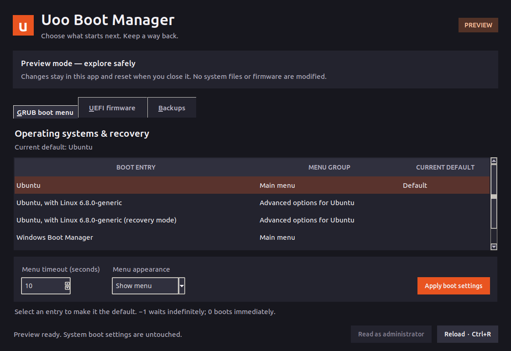

# Uoo Boot Manager

A native Python/Tkinter desktop app for Ubuntu that manages existing GRUB and UEFI boot settings.



## What it manages

- GRUB default boot entry, timeout, and menu visibility.
- UEFI boot order and the entry to use once on the next boot.
- Backups and restoration of settings changed by Uoo.

The desktop runs as your normal user. Changes and backup operations request administrator authentication through `pkexec`. Uoo writes its GRUB settings to `/etc/default/grub.d/zz-uoo.cfg`, then runs `update-grub`. Root-owned backups are stored in `/var/lib/uoo-boot-manager/backups`.

UEFI features require a machine booted in UEFI mode and `efibootmgr`. GRUB features require a GRUB installation and `update-grub`. Firmware behavior can vary between computers. Uoo manages existing entries; it does not create or delete entries, install or repair a bootloader, or reboot the computer.

## Build and install

From this directory on Ubuntu:

```sh
bash scripts/build-deb.sh
sudo apt install ./dist/uoo-boot-manager_1.0.0_all.deb
uoo-boot-manager
```

The package also adds **Uoo Boot Manager** to the application menu. Installing it does not change boot settings. Apply changes from the app when you are ready; boot changes take effect on a later boot.

The package depends on Python 3, Tkinter, and polkit. It recommends `grub-common` and `efibootmgr`; install those tools if you skipped recommended dependencies. Current Ubuntu packages split polkit into [`polkitd`](https://packages.ubuntu.com/noble/polkitd) and [`pkexec`](https://packages.ubuntu.com/noble/amd64/pkexec); [`policykit-1`](https://packages.ubuntu.com/noble/policykit-1) is a compatibility dependency for older releases.

## Try the demo

The demo uses sample boot entries and does not change the system:

```sh
sudo apt install python3-tk
python3 -m uoo --demo
```

You can inspect the real machine from the source directory with `python3 -m uoo`. Applying real changes requires the installed, root-owned helper at `/usr/lib/uoo-boot-manager/helper.py`. The backend uses only Python's standard library.

## Restore and uninstall

Use the app's backup view to restore a previous state while Uoo is installed. Restoration requests administrator authentication. Review which settings the selected backup covers before restoring it.

```sh
sudo apt remove uoo-boot-manager
```

Uninstalling preserves the GRUB settings drop-in and backups, so it does not silently change your boot behavior. To return to the previous settings, restore a backup **before** uninstalling. Existing firmware boot-order changes also remain after uninstalling.

The package build stages files under `build/` and writes the `.deb` to `dist/`; it does not install files or alter boot configuration on the build machine.

## Validation

Run `python3 -m unittest discover -s tests -v` from this directory. The tests use temporary GRUB files and simulated firmware, including failed updates and rollback. The desktop demo is also checked in a real Tk session. Actual firmware writes and booting require validation on a test Ubuntu machine.

GRUB settings follow the [GNU GRUB configuration reference](https://www.gnu.org/software/grub/manual/grub/html_node/Simple-configuration.html). Firmware actions use the options documented in Ubuntu's [efibootmgr manual](https://manpages.ubuntu.com/manpages/noble/man8/efibootmgr.8.html).
