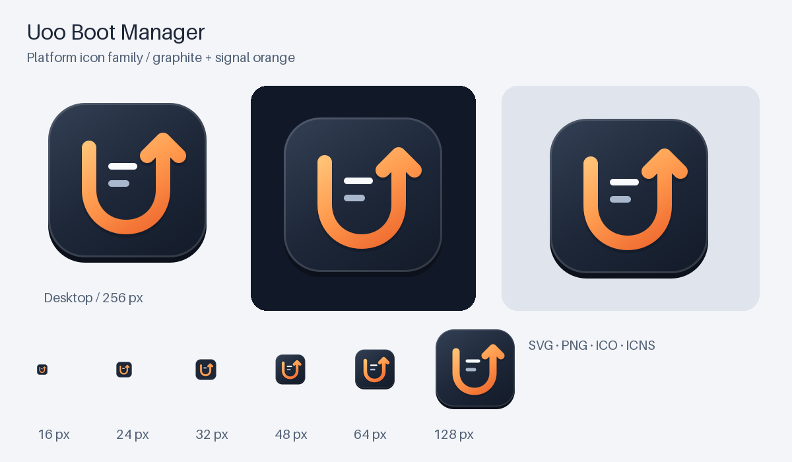

# Uoo icon family



The mark combines a **U**, an upward boot arrow, and boot-menu lines. Warm
amber/orange sits on a graphite tile, with transparent outer margins for
desktop use. The simplified small-size mark keeps its silhouette at 16 px.
The design is authored as native SVG; no AI-generated bitmap is embedded.

| Asset | Use |
| --- | --- |
| [uoo.svg](uoo.svg) | Editable 1024 px vector master and documentation |
| [png/](png/) | Desktop PNGs: 16, 24, 32, 48, 64, 128, 256, 512, 1024 px |
| [uoo-symbolic.svg](uoo-symbolic.svg) | Monochrome GTK symbolic icon |
| [uoo.ico](uoo.ico) | Windows icon with 16–256 px frames, including 20/40/96 px |
| [uoo.icns](uoo.icns) | macOS icon export, including Retina sizes through 1024 px |
| [favicon.svg](favicon.svg), [favicon.ico](favicon.ico) | Browser icons with a simplified small-size mark |
| favicon-16x16.png, favicon-32x32.png | Legacy browser PNGs |
| apple-touch-icon.png | Opaque 180 px Apple touch icon |
| android-chrome-192x192.png, android-chrome-512x512.png | Web/mobile icons |
| maskable-512x512.png | Android maskable icon with the mark in the safe area |
| [mask-icon.svg](mask-icon.svg) | Safari pinned-tab mask |
| [site.webmanifest](site.webmanifest) | Manifest referencing the web/mobile exports |

Linux packages install the app ID `org.uoo.BootManager` into the hicolor icon
theme. The source/demo and AppImage use the generated fallback theme under
`uoo/icons/`. Windows executables, the WPF header/window, and the installer use
the same generated resources. The `.icns` is an asset export; Uoo currently
ships Linux and Windows applications.

To regenerate after changing the SVG masters:

```sh
make deps-icons
make icons
```

The exporter needs Pillow, PyGObject/GdkPixbuf, and librsvg's SVG loader. Normal
builds consume checked-in exports and do not require these extra tools.
Generated copies in `packaging/`, `uoo/icons/`, and `windows/Uoo.Desktop/` must
be committed together with the masters.

For a website that serves this directory at `/assets/icons/`, use:

```html
<link rel="icon" href="/assets/icons/favicon.ico" sizes="any">
<link rel="icon" href="/assets/icons/favicon.svg" type="image/svg+xml">
<link rel="apple-touch-icon" href="/assets/icons/apple-touch-icon.png">
<link rel="mask-icon" href="/assets/icons/mask-icon.svg" color="#ee692f">
<link rel="manifest" href="/assets/icons/site.webmanifest">
<meta name="theme-color" content="#1d2738">
```

The repository does not currently contain a website. GitHub controls its own
tab favicon; repository README markup cannot replace that favicon.
